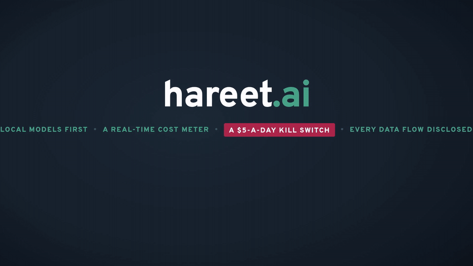

# h4reet.ai

An AI twin of the Author: an animated character, always disclosed as an AI, that visitors talk to by text or voice about the Author's real work. It is for hiring managers and engineering leads deciding whether to talk to the Author, and for engineers curious how it is made. It is also a worked example of how a small team ships production AI systems with agents in 2026, published with its full history, mistakes included.

> **Status: Phase 0, spec 000 in progress. No visitor-facing product yet.** Spec 000 builds the foundations on the Author's machine: the whole production stack in compose, with a real-time cost meter, a kill switch, a capped Bedrock fallback, and the governance the agents building it work under. Each user story is a feature branch the Author reviews and merges locally. Development is local until the Author publishes ([ADR 0013](docs/adr/0013-local-until-publication.md)), and the history is published from its first commit. [tasks.md](specs/000-local-foundations/tasks.md) tracks every task, [quickstart.md §7](specs/000-local-foundations/quickstart.md#7-done-when) lists the runs that close the spec, and each [merge-request note](docs/merge-requests/) records what ran, where, and what is still open.

> **About the first commits.** An enforcement layer can't gate its own creation, so the scaffold went onto `main` as one labeled bootstrap commit (`bootstrap: …`), followed directly by the constitution 1.0.1 amendment ([ADR 0012](docs/adr/0012-constitution-1-0-1-spec-kit-lifecycle.md)). Every change since then arrives on a feature branch that the Author reviews and merges; `git log --first-parent main` shows the sequence. The first of those branches ran in a session that the repository's own hooks didn't cover, and [its merge-request note](docs/merge-requests/2026-10-07-chore-gate-fixes-and-local-workflow.md) says so.

## What this is

- **The product** (Phases 1–3, not built yet). A visitor will pick a pre-generated avatar (no biometric data, such as faces or voiceprints, is collected), join the twin in a shared 3D room, and choose the engineer's or the non-engineer's version of the conversation. The twin will speak only from a curated corpus about the Author's work, and say so when it doesn't know.
- **The engineering** (spec 000, being built). Production-grade and local-first: the whole production stack runs as containers on the Author's RTX 5090 machine and calls local models, with a capped cloud fallback that is built and switched on once the Author sets up Bedrock (tasks.md T105). Its default host is one AWS VM, by the amendment of ADR 0044: there the Anthropic API answers first, and the laptop serves when the Author runs it. A real-time cost meter and a kill switch degrade the service before the budget breaks: $5 a day, $20 a month. Every flow of data that leaves the machine is listed, with what it carries and why, in the [data-flow disclosure](docs/data-flow-disclosure.md).
- **The process** (in force now). Changes go from intent to spec to plan to code to review. AI agents in named roles do most of the typing, and only the Author merges. Hooks and a sandbox enforce what the agents may do, and each stage commits its artifact, so the repository is its own audit trail; when a change skips a stage, its merge-request note says so and why.

## Films

Short narrated explainers of what the resume claims, each made from the system's own material: its config, its test output, its alerts, its disclosure, in the Author's words where the Author's words exist. Each film is written as code in [`films/`](films/), with its script, its captions, and a list of where every word and number on screen comes from. The narration is a synthetic voice (Kokoro), and where a spec isn't built yet, such as spec 001's outbound tunnel, a film shows the system as that spec describes it.

[](films/kill-switch-b2/media/kill-switch.mp4)

| Film | What it shows | Script · sources |
|---|---|---|
| **A $5-a-day kill switch** | The meter climbing on the breach test's synthetic calls, the warning at $3.50, and the trip at $5.00 that refuses every request, local answers too, until a person resets it with a reason in the audit log; the breach test's 52 assertions; the walls around the stack; and the agents that built it, each in one role, fenced in by the gates. | [script](films/kill-switch-b2/script.txt) · [sources](films/kill-switch-b2/materials.md) |
| **A real-time cost meter** | Cost as a first-class signal (the constitution's principle V): the room's sign showing what each call cost, from the gateway's own reply; provider, model, tokens, and cost on every call; money in whole micro-dollars; Langfuse inside the stack, locked down; spend beside latency and errors in Grafana; and why the app's own meter, not the cloud bill, is the control. | [script](films/cost-meter/script.txt) · [sources](films/cost-meter/materials.md) |
| **Every data flow disclosed** | The [data-flow disclosure](docs/data-flow-disclosure.md) and the build check that refuses a service without a row; what leaves a visitor's device and what never does; what reaches Anthropic when the paid fallback answers; then what the twin says back: only from the corpus, "I don't know yet" otherwise, checked by code before it leaves. | [script](films/data-flows/script.txt) · [sources](films/data-flows/materials.md) |
| **Tested every time it changes** | The evals: golden and gap cases drawn from the [corpus](corpus/README.md), asked two ways; grading by code, never by another model; the gateway's guards; the red team on every route; the real pass rates; misses that became fixes; readiness locked to a hash. | [script](films/evals/script.txt) · [sources](films/evals/materials.md) |
| **Local models first** | The whole production stack on one machine with one command; llama.cpp on the GPU, tried first at no cost with nothing leaving the machine; the capped paid fallback, and the cloud host where the Anthropic API answers first ([ADR 0044](docs/adr/0044-ec2-as-prods-default-host.md)); the offline-first discipline of the Author's work at Medic; and Denver Local AI's private AI for small Denver teams, with sensitive files kept on hardware they own. | [script](films/local-first/script.txt) · [sources](films/local-first/materials.md) |
| **The stack, container by container** | All fifteen containers of the production stack: what each does, why it is there, what happens when it fails, what alerts on it, and how it is observed; the edge as the only door, the gateway as the only road out, and the runbook every alert names. | [script](films/stack/script.txt) · [sources](films/stack/materials.md) |
| **How it's built** | The development lifecycle: intent, spec, plan, tasks, the agents in their roles, review by an agent that didn't write the change, bugs and incidents, the clean-room gate, the sandbox and its hooks, and pull-only deploys as spec 001 describes them. | [script](films/lifecycle/script.txt) · [sources](films/lifecycle/materials.md) |

## How to read this repo

The twin will ask each visitor which version they want, and this repository offers the same two paths. The facts are the same; the depth differs.

### Not an engineer? About ten minutes

1. [**The idea**](intent/000-ai-twin-portfolio.md), in the Author's own words: what the twin is for, and why it is built this way.
2. [**The constitution**](.specify/memory/constitution.md): eight principles. Principles VII and VIII say what the twin may say about the Author, and what it never will.
3. [**Why foundations come first**](specs/000-local-foundations/intent.md): spending limits and safety rails before any feature.
4. [**The kill switch, tripped on purpose**](docs/recordings/): spec 000's breach test, recorded in the terminal, as the spend crosses the ceiling, the stack's hello endpoint switches to its degraded response, and the real Telegram and email alerts arrive (SC-002). The recording is the Author's run (tasks.md T085); until it lands, the folder says so. Public dashboards follow in spec 001.
5. [**What leaves the machine**](docs/data-flow-disclosure.md): every flow, what it carries, and why. "No visitor data flows in this spec."
6. [**The merge requests**](docs/merge-requests/): each change, who approved it, and what the review found, including what went wrong.

### An engineer? Start with the gates

1. [**The constitution**](.specify/memory/constitution.md), then [**how we build**](docs/how-we-build/lifecycle.md): the artifact chain, the gates, and the layers that enforce each rule (skill, hook, sandbox, and what sits outside the session).
2. **The enforcement layer**: [`CLAUDE.md`](CLAUDE.md), [`REVIEW.md`](REVIEW.md), and [`.claude/`](.claude/), which holds the agent roles, `settings.json` (permissions and sandbox), and the hooks. [`redteam/forbidden-actions.sh`](redteam/forbidden-actions.sh) tests the hooks, the git hook, and the settings, and lists the gaps it knows about.
3. [**Spec 000**](specs/000-local-foundations/spec.md): the local production stack, cost control, and agent governance, as testable acceptance criteria. Its [plan](specs/000-local-foundations/plan.md) and contracts give every interface, [tasks.md](specs/000-local-foundations/tasks.md) every task and what each one found, and [quickstart.md](specs/000-local-foundations/quickstart.md) the runs that prove each user story.
4. [**The ADRs**](docs/adr/): each decision and the alternatives turned down.
5. [**The runbooks**](docs/runbooks/): what the operator does for each alert and degraded answer, and for the agents' engine and the local gate. With them, [the data-flow disclosure](docs/data-flow-disclosure.md): every flow that leaves the local tier.
6. [**The merge requests**](docs/merge-requests/): review findings and what was done about each.
7. [**The corpus rules**](corpus/README.md): how claims about the Author are tagged, attested, and turned into evals.
8. **Run the gates yourself**, in the devcontainer: the [quickstart](#quickstart-the-devcontainer) below. [`docs/START-HERE.md`](docs/START-HERE.md) has the Author's full setup, the stack's host included.

## Quickstart: the devcontainer

The devcontainer ([`.devcontainer/`](.devcontainer/)) holds every pinned tool, the versions the agents' sessions and the Author's gate use too. SC-007 sets its target: "A newcomer reaches a running devcontainer with passing tests in under 30 minutes." The Author times it at tasks.md T099, on a fresh clone with an empty build cache (quickstart.md §6.2). It needs Docker, and `npx` or VS Code to open it; nothing of the Author's: no Claude login, agents' engine, GPU, or denylist (plan §9).

```bash
git clone <repository URL> h4reet-ai && cd h4reet-ai
npx @devcontainers/cli@0.89.0 up --workspace-folder .               # builds the image; make setup runs when it starts
npx @devcontainers/cli@0.89.0 exec --workspace-folder . make test
npx @devcontainers/cli@0.89.0 exec --workspace-folder . make check
```

Or open the folder in VS Code and reopen it in the container. `make check` runs every local gate and prints PASS, FAIL, SKIP, PENDING, or PLANNED for each, then a summary; the gates that need a docker CLI print SKIP, with the reason. Outside the devcontainer and the agent sandbox, `make lint` and `make test` refuse to run, because they execute `node_modules` and test code from the working tree; each merge-request note carries their output instead. The stack itself (`make up`) needs the Author's host, which [`docs/START-HERE.md`](docs/START-HERE.md) and [quickstart.md](specs/000-local-foundations/quickstart.md) set up.

## The artifact chain

| Stage | Artifact | Where |
|---|---|---|
| Plan | `intent.md`, in the originator's words | [`intent/`](intent/) |
| Design | `spec.md`, with its clarifications | [`specs/`](specs/) |
| Build | `plan.md`, `tasks.md`, the diff and its tests | `specs/NNN-*/` and a feature branch |
| Test | test output, eval and red-team results | the merge-request note; `evals/` and `redteam/` |
| Deploy | the `REVIEW.md` passes by an agent that didn't write the change, then the Author's merge | a note in [`docs/merge-requests/`](docs/merge-requests/) until publication, then the pull request |
| Maintain | incident notes, then the next intent | [`docs/incidents/`](docs/incidents/) |

Each stage ends by committing the artifact the next stage reads, and decisions along the way become ADRs in [`docs/adr/`](docs/adr/). The full table, with who produces each artifact and the gate that ends each stage, is in [`docs/how-we-build/lifecycle.md`](docs/how-we-build/lifecycle.md).

## Specs

| Spec | Scope | Status |
|---|---|---|
| [000: local foundations](specs/000-local-foundations/spec.md) | Governance, agents, and the whole production stack in compose on the local tier, metered and kill-switched | Clarified and planned; being built, one branch per user story ([tasks](specs/000-local-foundations/tasks.md)) |
| [001: cloud elevation](specs/001-cloud-elevation/spec.md) | The same stack in one AWS account, with Terraform | Draft; specified in full once 000 is built |
| Publication (not yet numbered) | What only GitHub can enforce or show, moved out of spec 000 and listed in [its carryover file](specs/000-local-foundations/publication-carryover.md): the public repository, CI on hosted runners, secret scanning in CI, the reviewer GitHub Action, branch protection, and Dependabot | Moved out of 000 on 2026-10-07 ([ADR 0014](docs/adr/0014-github-side-requirements-to-a-publication-spec.md)); needs an intent |

## Links

- [Constitution](.specify/memory/constitution.md): supersedes everything else in the repository
- [Intent inbox](intent/) · [Specs](specs/) · [ADRs](docs/adr/) · [Merge requests](docs/merge-requests/) · [Incidents](docs/incidents/)
- [How we build](docs/how-we-build/lifecycle.md) · [Start here](docs/START-HERE.md): the Author's setup and session notes
- [Data-flow disclosure](docs/data-flow-disclosure.md) · [Runbooks](docs/runbooks/) · [Recordings](docs/recordings/) · [Research notes](docs/research/)
- [Contributing](CONTRIBUTING.md): we accept intents, not pull requests, from outside
- [Security policy](SECURITY.md)
- Licenses: the [MIT license](LICENSE) for the code. The studio's assets in [`assets/`](assets/README.md), and the images published under `docs/research/images/`, are all rights reserved, with viewing and linking welcome: each directory's `LICENSE.md` says so ([ADR 0030](docs/adr/0030-media-license-and-ai-mark.md)).
