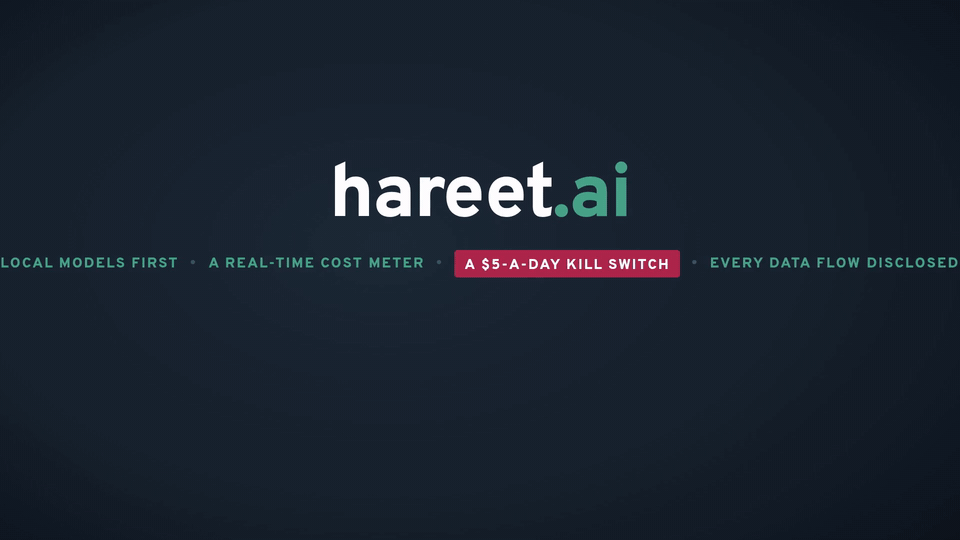

# A $5-a-day kill switch

The meter climbing on the breach test's synthetic calls, the warning at $3.50, and the trip at $5.00 that refuses every request until a person resets it; the breach test's 52 assertions; the walls around the stack; the agents that built it and the gates that fence them in.

**[Watch the film](media/kill-switch.mp4)**
The film (MP4, with sound; the narration is a synthetic voice) arrives with the media commit.

- [Script](script.txt) · [Captions](captions.srt) · [Where every word and number comes from](materials.md) · [Treatment](treatment.md)
- Made as code with the huashu-motion skill: [`index.html`](index.html) is the film. See [the films' README](../README.md) for how they're rendered.
